<div align="center">
  
  <br />
  
</div>

<p dir="rtl" align="center"><strong>فضایی یکپارچه برای گفتگو، ایده‌پردازی، توسعه‌ی نرم‌افزار و اجرای پروژه‌های کدنویسی؛ همه در یک محیط متمرکز.</strong></p>

<p dir="ltr" align="center">
  <a href="https://github.com/aishervin/codein" title="GitHub"></a>
  &nbsp;&nbsp;
  <a href="https://github.com/aishervin/codein/releases/latest" title="Download"></a>
  &nbsp;&nbsp;
  <a href="https://t.me/shervini" title="Telegram"></a>
  &nbsp;&nbsp;
  <a href="https://x.com/shervinonx" title="X"></a>
</p>

<p dir="ltr" align="center">
  <a href="https://github.com/aishervin/codein/releases/latest"></a>
  <a href="https://github.com/aishervin/codein/actions/workflows/android-ci.yml"></a>
  
</p>

<p align="center"></p>

<h2 dir="rtl" align="right">درباره‌ی CODΞiN</h2>

<p dir="rtl" align="right"><bdi dir="ltr">CODΞiN™</bdi> یک اپلیکیشن اندرویدی با هویت <bdi dir="ltr">SHΞN™</bdi> است که گفتگو با مدل‌های هوش مصنوعی و ابزارهای توسعه را در محیطی یکپارچه گرد هم می‌آورد. از ایده‌پردازی و حل مسائل برنامه‌نویسی تا کار با پروژه‌های محلی، CODΞiN تلاش می‌کند تجربه‌ای متمرکز، منعطف و کاربردی برای توسعه‌دهندگان فراهم کند.</p>

<h2 dir="rtl" align="right">قابلیت‌ها</h2>

<h3 dir="rtl" align="right">گفتگو با مدل‌های هوش مصنوعی</h3>
<ul dir="rtl" align="right">
  <li>دریافت و نمایش پاسخ‌ها به‌صورت زنده و هم‌زمان با تولید محتوا.</li>
  <li>شناسایی مدل‌های در دسترس از سرویس‌دهنده‌های مختلف و بررسی عملکرد آن‌ها پیش از اضافه‌شدن به فهرست مدل‌های گفتگو.</li>
  <li>امکان آزمایش مدل‌ها با کلید موقت، بدون ذخیره‌ی آن در تنظیمات برنامه.</li>
  <li>پشتیبانی از مدل‌های مختلف با قابلیت انتخاب مدل متناسب با نیاز هر گفتگو.</li>
  <li>دسترسی به مدل‌های <bdi dir="ltr"><code>ZERO</code></bdi> و <bdi dir="ltr"><code>HERO</code></bdi>، مدیریت تاریخچه‌ی گفتگوها و شروع مکالمه‌های جدید.</li>
</ul>

<h3 dir="rtl" align="right">ابزارهای کدنویسی</h3>
<ul dir="rtl" align="right">
  <li>نمایش خوانای کد با رنگ‌بندی اختصاصی و قاب نارنجی.</li>
  <li>کپی سریع کد، دریافت فایل با نام متناسب با زبان برنامه‌نویسی و امکان تلاش دوباره برای دریافت پاسخ.</li>
  <li>امکان افزودن فایل‌های متنی تا حجم یک مگابایت به گفتگو.</li>
</ul>

<h3 dir="rtl" align="right">Termux MCP و Agent Room</h3>
<ul dir="rtl" align="right">
  <li>ارتباط با محیط محلی Termux برای اجرای فرمان‌ها و تعامل با پروژه‌های توسعه.</li>
  <li>محیط مشترک <bdi dir="ltr">Agent Room</bdi> برای همکاری ابزارها و عامل‌های هوش مصنوعی.</li>
  <li>نمایش فرمان‌های پیشنهادی و دریافت تأیید کاربر پیش از اجرای آن‌ها.</li>
  <li>نمایش و همگام‌سازی وضعیت اتصال Termux در بخش‌های مختلف برنامه.</li>
  <li>امکان به‌روزرسانی پل ارتباطی Termux بدون حذف توکن اتصال و داده‌های محلی.</li>
</ul>

<h3 dir="rtl" align="right">اتصال به سرویس‌های خارجی</h3>
<p dir="rtl" align="right">با استفاده از <bdi dir="ltr">Composio</bdi> می‌توان ابزارها و سرویس‌های خارجی را شناسایی و اتصال آن‌ها را مدیریت کرد. این قابلیت مسیر توسعه‌ی یکپارچگی‌های بیشتر با سرویس‌های مختلف را فراهم می‌کند.</p>

<p align="center"></p>

<h2 dir="rtl" align="right">نصب و راه‌اندازی</h2>

<p dir="rtl" align="right">برای دریافت نسخه‌ی رسمی و امضاشده‌ی برنامه، به صفحه‌ی انتشارهای مخزن مراجعه کنید:</p>

<p dir="rtl" align="center">
  <a href="https://github.com/aishervin/codein/releases/latest"><strong>دریافت آخرین نسخه‌ی CODΞiN™</strong></a>
</p>

<p dir="rtl" align="right">CODΞiN روی دستگاه‌های مجهز به <bdi dir="ltr"><code>Android 7.0</code></bdi> و نسخه‌های بالاتر قابل اجراست.</p>

<p dir="rtl" align="right">برای استفاده از قابلیت‌های <bdi dir="ltr">Agent Room</bdi> و ارتباط با محیط Termux، ابتدا Termux را نصب کنید. سپس دستورهای زیر را در محیط آن اجرا کنید تا پل ارتباطی CODΞiN نصب یا به‌روزرسانی شود:</p>

```bash
pkg install -y curl
curl -fsSL https://raw.githubusercontent.com/aishervin/codein/main/termux/codein-bootstrap.sh | bash

<p dir="rtl" align="right">پس از راه‌اندازی، توکن اتصال محلی را در تنظیمات CODΞiN وارد کنید. سرویس ارتباطی به‌صورت پیش‌فرض فقط روی <bdi dir="ltr"><code>127.0.0.1</code></bdi> در دسترس است و از شبکه‌ی محلی قابل دسترسی نیست.</p><p dir="rtl" align="right">در صورت نصب فایل APK خارج از Google Play، ممکن است Android هشدار امنیتی عمومی نمایش دهد. برای اطمینان از اصالت فایل، آن را فقط از صفحه‌ی انتشار رسمی این مخزن دریافت کنید.</p><h2 dir="rtl" align="right">حریم خصوصی و امنیت</h2><p dir="rtl" align="right">CODΞiN با هدف فراهم‌کردن محیطی متمرکز و قابل‌کنترل برای کاربر طراحی شده است. کلیدهای سرویس‌دهنده در مخزن محلی Termux نگهداری می‌شوند و اجرای فرمان‌های محلی به تأیید کاربر نیاز دارد.</p><p dir="rtl" align="right">ارتباط پل MCP به میزبان محلی محدود است. برای دریافت پاسخ، محتوای گفتگو به سرویس‌دهنده‌ی مدل انتخاب‌شده ارسال می‌شود؛ بنابراین نحوه‌ی پردازش و نگهداری داده‌ها تابع سیاست‌های همان سرویس‌دهنده نیز خواهد بود.</p><h2 dir="rtl" align="right">ارتباط و مشارکت</h2><p dir="rtl" align="right">برای گزارش مشکلات، ارائه‌ی پیشنهادها یا اطلاع از انتشار نسخه‌های جدید، می‌توانید از پیوندهای ارتباطی بالای این صفحه استفاده کنید.</p><p align="center"></p><div dir="ltr" align="center">
  <sub>Designed and crafted for focused conversations and code · SHΞЯVIN™</sub>
</div>
```
